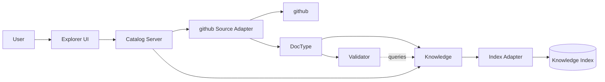
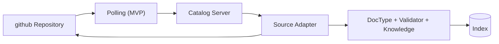

# Catalog Server

`Catalog Server` provides centralized access to distributed documentation sources.

It combines source access, indexing, authentication and query execution while keeping repositories as the source of truth.

## Technology

- TypeScript / Node.js
- Fastify as HTTP server framework
- feature-based application structure
- Fastify Autoload for automatic registration of features and plugins
- OpenAPI for API description and client generation
- GitHub OAuth for user authentication
- Source Adapters for accessing remote repositories
- Knowledge + Index Adapter for central indexing and querying
- background synchronization based on polling
- deployable and usable independently from the Explorer UI

## Main libraries

- fastify
- @fastify/autoload
- @fastify/swagger
- @fastify/swagger-ui
- OAuth / OIDC plugin for GitHub authentication
- Dokkurator core libraries and adapters

A feature owns its routes, service logic and related schemas:

```text
src/
├── plugins/
│   ├── auth/
│   ├── knowledge/
│   └── sources/
│
└── features/
    ├── documents/
    ├── search/
    ├── repositories/
    └── synchronization/
```

Fastify plugins provide shared infrastructure, while features contain the application-specific server functionality.

## Responsibilities

- authenticate users
- access configured remote repositories
- synchronize repository content into the central index
- expose search and query functionality
- apply repository permissions to user requests
- provide document and relation data to Explorer UI and other clients

## Architecture



## Authentication

Interactive users authenticate through github OAuth.

```text
User
  ↓
Catalog Server
  ↓
github OAuth
  ↓
github identity + access token
  ↓
Catalog session
```

The server owns:

- OAuth flow
- user session
- access token handling
- permission resolution

github remains the authority for repository access.

The Catalog Server may cache or index permission-related information for efficiency, but access decisions must remain compatible with current github permissions.

Possible strategies include:

- repository-level access metadata in the index
- permission checks during query execution

Authorization is a server concern and is not implemented inside Knowledge or the Index Adapter.

## Synchronization

Repositories are periodically synchronized with the Knowledge index.



Synchronization should preferably be incremental:

```text
added files
modified files
removed files
        ↓
parse affected documents
        ↓
update derived knowledge
        ↓
update index
```

A complete reindex must remain possible. Indexing is authenticated by github auth-token.

## Query flow

Queries are executed against the central index.

```text
User query
    ↓
Catalog Server
    ↓
resolve user permissions
    ↓
 query authorized results only
    ↓
Knowledge query
    ↓
Index Adapter
    ↓
response
```

The server must ensure that centralized search does not expose documents the user could not access in the underlying source system.

## Deployment

The Catalog Server can run independently of the Explorer UI.

```text
CLI / External Client ─┐
                       ├── Catalog Server ── Knowledge Index
Explorer UI ───────────┘
```

This allows the server to be used as a standalone documentation search and knowledge service.

## Boundaries

- Repository configuration is file-based and managed outside the Explorer UI.
- An administrative UI for managing repositories is out of scope for the MVP.
- Administrative API endpoints for repository configuration are also out of scope for the MVP.
