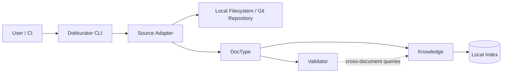

# CLI architecture

The CLI operates directly on accessible sources.

Typical sources are:

- a local directory,
- a local Git repository,
- repository contents available inside a CI pipeline.

No central Dokkurator server is required.



Possible CLI workflows include:

```text
repository
   ↓
parse
   ↓
validate
   ↓
index
   ↓
search / query / inspect
```

The local index is derived data and can be rebuilt from the repository.
