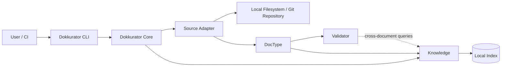

# CLI architecture

The CLI delegates application workflows to `@dokkurator/core`. Core coordinates
accessible sources and the Knowledge index through the public package APIs.

Typical sources are:

- a local directory,
- a local Git repository,
- repository contents available inside a CI pipeline.

No central Dokkurator server is required.



Possible CLI workflows include:

```text
repository
   ↓
parse
   ↓
validate
   ↓
index
   ↓
search / query / inspect
```

The `search` command accepts the Knowledge query language. The CLI forwards the
input to Knowledge and only formats results; parsing and storage translation do
not belong to the CLI layer.

```text
dokkurator search authentication
dokkurator search status:accepted
dokkurator search "authentication AND owner.team:platform"
```

The local index is derived data and can be rebuilt from the repository.
