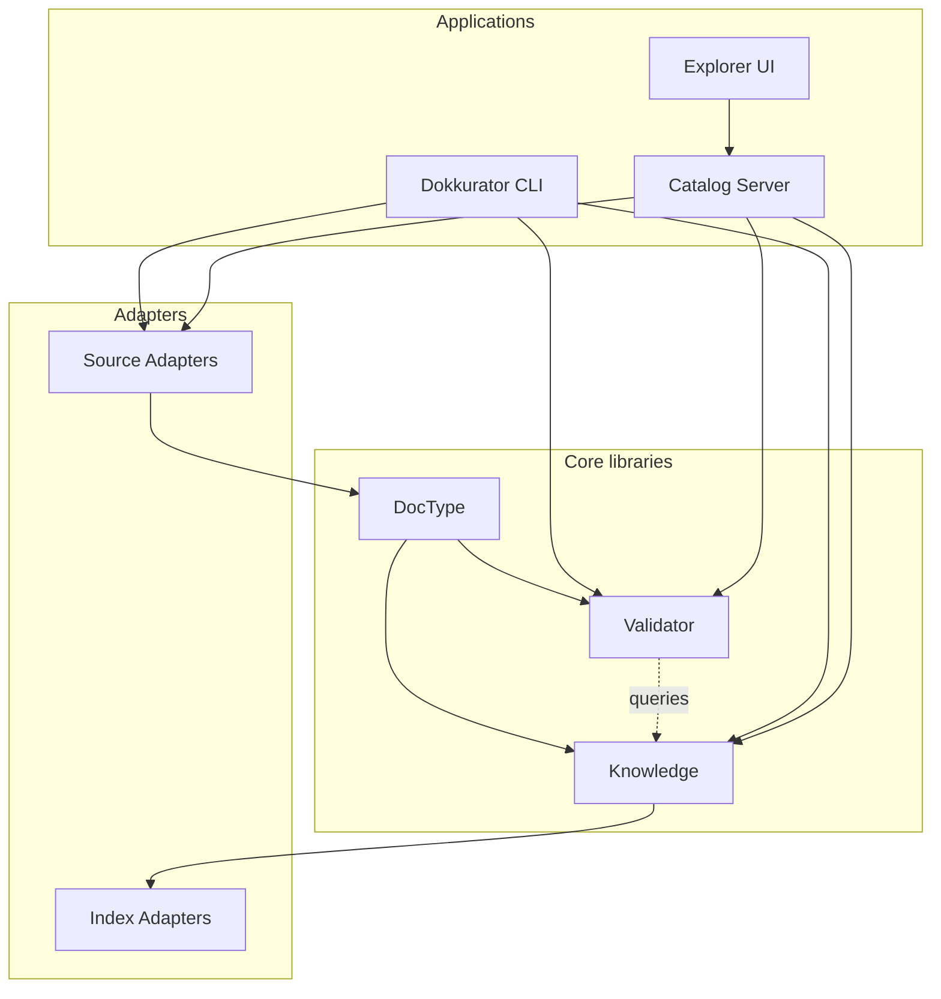

# Architecture Overview

## Purpose

Dokkurator is built as a set of loosely coupled components for working with structured documentation.

The core principles are:

- documents remain in their existing repositories,
- Markdown and Frontmatter stay the primary open formats,
- repositories remain the source of truth,
- indexes are derived and can be rebuilt,
- core functionality is reusable independently of the central server,
- infrastructure-specific integrations are connected through adapters.

The architecture supports two main usage modes:

1. **local / CI usage through the CLI**
2. **central access through the Catalog Server and Explorer UI**

---

## Building blocks



Detailed architecture is documented separately:

| Building block  | Documentation                              | Responsibility                                                                                                     |
| --------------- | ------------------------------------------ | ------------------------------------------------------------------------------------------------------------------ |
| DocType         | [`doctype.md`](doctype.md)                 | Defines, parses and normalizes structured documents based on Markdown, Frontmatter and document type definitions.  |
| Validator       | [`validator.md`](validator.md)             | Validates documents against structural, metadata and cross-document rules.                                         |
| Knowledge       | [`knowledge.md`](knowledge.md)             | Builds the searchable knowledge model from parsed documents, references and relationships.                         |
| Source adapters | [`source-adapters.md`](source-adapters.md) | Provide documents and source metadata from filesystems, Git repositories and remote Git providers.                 |
| Index adapters  | [`index-adapters.md`](index-adapters.md)   | Abstract persistence and querying of the derived knowledge index from the underlying storage technology.           |
| CLI             | [`cli.md`](cli.md)                         | Exposes local and CI workflows for validation, indexing, search and inspection.                                    |
| Catalog Server  | [`catalog-server.md`](catalog-server.md)   | Provides centralized indexing, synchronization, authentication and query APIs for shared documentation sources.    |
| Explorer UI     | [`explorer-ui.md`](explorer-ui.md)         | Provides the browser-based interface for searching, navigating and inspecting documentation and its relationships. |

---

# Source of truth

Dokkurator distinguishes between authoritative and derived data.

```text
Git repository
      │
      │ authoritative
      ▼
Markdown + Frontmatter
      │
      │ parse / validate / index
      ▼
Knowledge Index
      │
      │ derived
      ▼
Search / Graph / Health / Navigation
```

The index may contain additional derived information such as:

- normalized metadata,
- resolved references,
- relationships,
- entities,
- validation state,
- search data.

These values can always be recreated from the repositories and configuration.

---

# Architectural principles

- **Repositories remain authoritative** - Dokkurator does not become the primary storage location for documentation.
- **Open formats first** - Documents remain readable and editable without Dokkurator.
- **Use existing libraries where possible** -
- **Core libraries are infrastructure-independent** - GitLab, GitHub, databases and search engines are connected through adapters.
- **Local usage remains possible** - The CLI must not depend on the Catalog Server for fundamental parsing, validation or indexing workflows.
- **The index is disposable** - The index can be updated incrementally for efficiency, but it must remain possible to rebuild it completely from its sources.
- **Authorization follows the source** - Central search must not bypass the access restrictions of the underlying repositories.
