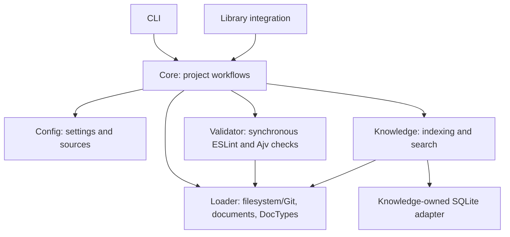
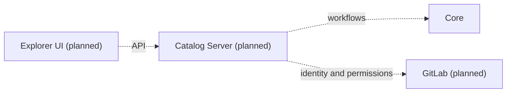

# Architecture Overview

Dokkurator keeps Markdown and YAML Frontmatter in their source repositories.
Its libraries add loading, validation, and a disposable search index. A DocType
is a domain concept, not a separate workspace package.

## Implemented flow

Arrows denote dependencies through public root APIs. Loader owns source contracts
and adapters. Knowledge depends on Loader's contracts and parsed models, not on
filesystem or Git implementations. Core coordinates the libraries; CLI delegates
to Core. Validation and indexing are separate operations: validation findings are
not yet persisted in Knowledge. CLI validation is planned; Core and ESLint
validation are available today.

## Building blocks

| Component       | Current responsibility                                         | Documentation                             |
| --------------- | -------------------------------------------------------------- | ----------------------------------------- |
| Config          | Discover, validate, and resolve project/source configuration   | [Config](../../packages/config/README.md) |
| Core            | Coordinate source lifecycle, validation, indexing, and queries | [Core](../../packages/core/README.md)     |
| Loader          | Read sources, parse documents, load and normalize DocTypes     | [Loader](loader.md)                       |
| Validator       | Check metadata, headings, and configured ESLint rules          | [Validator](validator.md)                 |
| Knowledge       | Index documents and query text and metadata                    | [Knowledge](knowledge.md)                 |
| Source adapters | Loader-owned filesystem/Git access and change detection        | [Source adapters](source-adapters.md)     |
| Index adapters  | Knowledge-owned persistence contract and SQLite implementation | [Index adapters](index-adapters.md)       |
| CLI             | Local source management, indexing, search, and inspection      | [CLI](cli.md)                             |

## Planned central reference application

Catalog Server and Explorer UI together form the planned central reference
application, called “Hub” in earlier notes. They are currently scaffolds:
Catalog Server exposes an OpenAPI contract; Explorer UI is a React/Vite starter.
Neither implements a complete catalog workflow.

The [server design](catalog-server.md) and [UI design](explorer-ui.md) describe
target behavior. GitLab OAuth, permission-filtered search, resolved document
relationships, cross-document validation, and quality reports remain planned.

## Responsibilities

- Preserve repositories as the source of truth.
- Make loading, validation, and search usable independently as libraries.
- Coordinate project workflows through Core and the CLI.
- Keep derived index data rebuildable from sources and configuration.

## Boundaries

- Consume other packages only through their public root APIs.
- Keep source adapters in Loader and index adapters in Knowledge.
- Keep document parsing in Loader, local checks in Validator, and queries in Knowledge.
- Keep the CLI focused on arguments and output rather than implementation logic.
- Implement authentication and authorization in the future server integration.

## Current limitations

Git loading and validation see the working tree, while incremental Git indexing
reads committed revisions. Malformed YAML aborts indexing for that source.
Include/exclude changes do not yet reliably reconcile indexed documents.
These limitations also affect demos and watch workflows.

The current index contains content, metadata, headings, links, Markdown link
references, and basic source provenance. Extracted links are not resolved semantic
relationships; authorization data and validation findings are not yet indexed.
