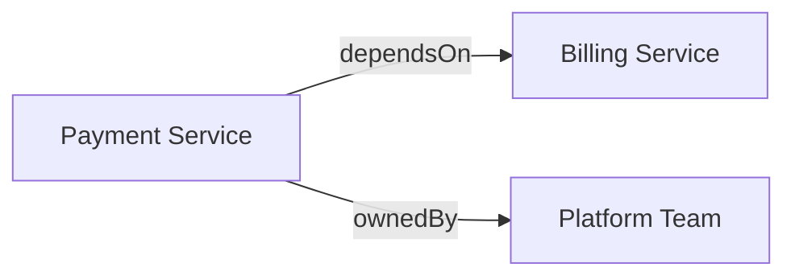

# Dokkurator – Knowledge und Relationen

## Alternativen für das Relationsmodell

### A – Freie, untypisierte Referenzen

```ts
interface Reference {
  source: string;
  target: string;
  label?: string;
}
```

**Vorteile:** Minimaler Einstieg, flexibel, für Linkgraphen geeignet.  
**Nachteile:** Uneinheitliche Bezeichnungen (`dependsOn`, `requires`); keine definierte Semantik und schwache Typprüfung.  
**Eignung:** Exploration und unstrukturierte Dokumentation.

### B – Generische Relation + eigenständiger RelationType

```ts
interface Relation {
  source: string;
  predicate: string;
  target: ReferenceTarget;
}

interface RelationType {
  id: string;
  sourceTypes?: string[];
  targetTypes?: string[];
  acyclic?: boolean;
}
```

Beispiel einer Typdefinition:

```yaml
id: dependsOn
sourceTypes: [service]
targetTypes: [service]
acyclic: false
```

**Vorteile:** Gemeinsamer fachlicher Wortschatz, zentral definierbare Constraints, typisierte Abfragen und wiederverwendbare Domain Packs.  
**Nachteile:** Zusätzliche Artefakte, Namespaces, Versions- und Kompatibilitätsfragen.  
**Eignung:** Typisierte, repo- und domainübergreifende Wissensmodelle.

### C – Beziehungen ausschließlich innerhalb von DocTypes definieren

```yaml
id: service
fields:
  dependencies:
    type: reference[]
    target: service
```

**Vorteile:** Wenige Konzepte, nahe an bestehendem DocType-Modell, schnell konfigurierbar.  
**Nachteile:** Bedeutung derselben Beziehung kann zwischen DocTypes auseinanderlaufen; gemeinsame Semantik ist nur eingeschränkt möglich.  
**Eignung:** Kleine, dokumentzentrierte Anwendungen.

### D – RDF-artige Beziehungen und externe Vokabulare

Beispiel: `service:payment software:dependsOn service:billing`.

**Vorteile:** Standardisierung, globale Identifikatoren, Interoperabilität, vorhandene Vokabulare und SHACL-Validierung.  
**Nachteile:** Höhere konzeptionelle und technische Einstiegskosten; nicht zwangsläufig passend für den MVP.  
**Eignung:** Linked Data, Forschung, Verwaltung, systemübergreifender Austausch.

| Kriterium                   | A: Freie Referenzen | B: RelationTypes | C: DocType-Felder | D: RDF                               |
| --------------------------- | ------------------- | ---------------- | ----------------- | ------------------------------------ |
| Einstieg                    | Sehr einfach        | Mittel           | Einfach           | Komplexer                            |
| Typprüfung                  | Kaum                | Gut              | Gut               | Stark (mit zusätzlicher Validierung) |
| Gemeinsamer Wortschatz      | Nein                | Ja               | Eingeschränkt     | Ja                                   |
| Domain-Packs                | Möglich             | Sehr passend     | Sehr passend      | Passend                              |
| Unabhängigkeit von DocTypes | Hoch                | Hoch             | Gering            | Hoch                                 |
| Standard-Interoperabilität  | Gering              | Über Mapping     | Über Mapping      | Hoch                                 |
| MVP-Aufwand                 | Niedrig             | Mittel           | Niedrig           | Eher hoch                            |

**Research-Hypothese, keine Entscheidung:** Kombination von **B und C**: Relationstypen können gemeinsam definiert werden; DocTypes legen ihre Verwendung und Fundstellen fest. Die Graphinstanzen werden einheitlich repräsentiert. RDF/SHACL werden als mögliche Austausch- oder Validierungsoption untersucht.

## Wo Definitionen und Angaben liegen können

Die **Definition der Bedeutung** ist von der **Angabe einer konkreten Relation** zu trennen.

### 4.1 Definitionsebene

| Ort                  | Möglicher Inhalt                                             | Gültigkeitsbereich    |
| -------------------- | ------------------------------------------------------------ | --------------------- |
| Dokkurator Core      | Technische Basistypen und Schnittstellen                     | Alle Anwendungen      |
| Domain Pack          | Fachvokabular, RelationTypes, DocTypes, Regeln und Templates | Nutzer des Packs      |
| Projektkonfiguration | Eigene Typen, Paketregistrierung, Konventionen und Mappings  | Projekt               |
| DocType              | Erlaubte Relationen, Zieltypen, Fundstellen, Constraints     | Dokumente dieses Typs |
| Dokument             | Konkrete Referenzen und Aussagen                             | Dokumentinstanz       |

**Offen:** Sind RelationTypes eigene YAML-Artefakte oder dürfen sie lokal in DocTypes bzw. Domain Packs definiert werden? Wie funktionieren Namespaces, Überschreibungen und Versionierung?

### Quellen konkreter Relationen

| Quelle            | Beispiel                             | Interpretation                                  |
| ----------------- | ------------------------------------ | ----------------------------------------------- |
| Frontmatter       | `owner: team-a`                      | Deklarative Referenz                            |
| Markdown-Link     | `[ADR](adr.md)`                      | Expliziter Link, zunächst neutral               |
| Wiki-Link         | `[[ADR-004]]`                        | Expliziter Link, Parser-Erweiterung nötig       |
| Markdown-Section  | Links unter `## Dependencies`        | Durch Abschnitt semantisch eingeordnet          |
| Markdown-Tabelle  | Service-/Owner-Spalten               | Strukturierte Datensätze und Beziehungen        |
| Mermaid           | `A --> B`                            | Diagrammkante; Bedeutung nicht automatisch klar |
| Dateiname         | `ADR-004-supersedes-002.md`          | Namenskonvention                                |
| Verzeichnis       | `teams/platform/services/payment.md` | Hierarchisch abgeleitete Zuordnung              |
| Dateimuster       | `payment.spec.md` ↔ `payment.md`     | Musterbasierte Beziehung                        |
| Git-Metadaten     | Commit, Autor, Änderungen            | Provenienz und Historie                         |
| Externe Metadaten | Manifest, Katalog, API               | Ergänzende Aussagen                             |
| Fließtext         | „A benötigt B“                       | Nur potenzielle semantische Relation            |

Alle Quellen könnten auf ein gemeinsames Zwischenmodell normalisiert werden:

```ts
interface RelationCandidate {
  source: string;
  predicate?: string;
  target: ReferenceTarget;
  evidence: Evidence;
}
```

Die gezeigten Interfaces sind **Illustrationen**, keine festgelegte öffentliche API.

## 5. Pfade und Dateinamen als Relationsquellen

Verzeichnisstruktur kann fachliche Informationen transportieren:

```text
docs/
  teams/
    platform/
      team.md
      services/
        payment.md
        billing.md
```

Eine Konvention könnte `payment ownedBy platform` ableiten. Drei denkbare Orte der Konfiguration:

### Variante 1 – Projektweite Konventionen

```yaml
conventions:
  - match: "docs/teams/*/services/*.md"
    relation: ownedBy
    target: "docs/teams/{1}/team.md"
```

**Pro:** Ein Mapping für viele Dateien, gut für bestehende Bestände.  
**Contra:** Fachliche Aussagen hängen möglicherweise unbemerkt von der Ablagestruktur ab.

### Variante 2 – Pfadmuster im DocType

```yaml
id: service
relations:
  ownedBy:
    from:
      path: "docs/teams/{team}/services/*.md"
    target: "docs/teams/{team}/team.md"
```

**Pro:** Zusammenhang zwischen Dokumenttyp und Relation direkt sichtbar.  
**Contra:** DocType wird an konkrete Repository-Layouts gekoppelt.

### Variante 3 – Separates Repository-Mapping

```yaml
mappings:
  - source:
      glob: "docs/teams/*/services/*.md"
      doctype: service
    extract:
      team: path.segment(2)
    relations:
      ownedBy:
        target: "team:{team}"
```

**Pro:** Fachliches Vokabular bleibt unabhängig von konkreten Pfaden.  
**Contra:** Weitere Konfigurationsschicht und Zuordnungslogik.

**Research-Hypothese:** Ein separates Mapping-Profil ist besonders für Onboarding und wiederverwendbare Domain Packs interessant.

**Wichtige Regel:** `containedIn` / `locatedAt` (strukturelle Beziehung) ist nicht automatisch `ownedBy` / `dependsOn` (fachliche Beziehung). Die fachliche Interpretation muss explizit definiert werden.

## Referenzen auf Artefakte außerhalb von Markdown

Nicht nur Sourcecode kann ein Referenzziel sein. Ein allgemeineren Begriff wäre **Artifact Reference**.

| Domäne              | Artefakt         | Denkbare Relation |
| ------------------- | ---------------- | ----------------- |
| Software            | Sourcecode-Datei | `implementedIn`   |
| Software            | API-Endpunkt     | `exposes`         |
| Software            | Testfall         | `verifiedBy`      |
| Projektmanagement   | Ticket           | `trackedBy`       |
| Verwaltung          | Verordnung       | `governedBy`      |
| Forschung           | Datensatz        | `usesDataset`     |
| Forschung           | Publikation      | `cites`           |
| Qualitätsmanagement | Prüfprotokoll    | `verifiedBy`      |
| Bildung             | Lernmaterial     | `usesMaterial`    |
| Organisation        | Prozess          | `followsProcess`  |

Illustratives Zielmodell:

```ts
type ReferenceTarget =
  | { kind: "document"; id: string }
  | { kind: "entity"; id: string }
  | { kind: "artifact"; uri: string };
```

**Offen:** Welche Identifikatoren und Resolver werden benötigt? Wann bleibt ein Artefakt externes Referenzziel, wann wird es als eigener Knoten indexiert? Wie werden Berechtigungen und Provenienz berücksichtigt?

## Mermaid als strukturierte Quelle

Beispiel:



Die Kanten sind syntaktisch erkennbar; ihre fachliche Bedeutung und die Identität der Knoten müssen jedoch separat geklärt werden. Ein unbeschrifteter Pfeil kann Datenfluss, Ablauf, Aufruf oder Abhängigkeit bedeuten. Auch der Diagrammtyp beeinflusst die Semantik.

| Integrationsstufe             | Umfang                                      | Schwierigkeit                |
| ----------------------------- | ------------------------------------------- | ---------------------------- |
| 1. Syntaxprüfung              | Gültiges Mermaid?                           | Gering bis mittel            |
| 2. Struktur-Extraktion        | Knoten und Kanten finden                    | Mittel                       |
| 3. Identitätsauflösung        | Diagrammknoten konkreten Entitäten zuordnen | Mittel bis hoch              |
| 4. Semantische Interpretation | Fachliche Relation bestimmen                | Hoch, ohne explizite Angaben |
| 5. Konsistenzprüfung          | Aussagen mit anderen Quellen vergleichen    | Hoch                         |

Drei Strategien:

1. **Nur Inhalt:** Mermaid rendern und ggf. syntaktisch prüfen, aber nicht für den Graphen auswerten.
2. **Explizit gekennzeichnete Diagramme:** DocType oder Mapping definiert, wie eine bestimmte Section und Diagrammart auszuwerten ist.
3. **Allgemeine Diagrammquelle:** Parser überführt Diagramme in ein Zwischenmodell; Domain Pack interpretiert Beziehungen.

Für einen MVP ist Strategie 1 oder eine begrenzte Variante von 2 naheliegend. Bei späterer Extraktion sollten bestehende Parser verwendet werden, keine eigenentwickelte Syntaxzerlegung per Regex.

## Verbindlichkeit, Mehrfachbelege und Konflikte

Dieselbe Relation kann aus unterschiedlichen Quellen stammen:

```text
Frontmatter: Payment → ownedBy → Platform
Dateipfad:   Payment → ownedBy → Backend
Mermaid:     Payment → ownedBy → Platform
```

Daraus ergeben sich Fragen nach Autorität, Konflikten und Mehrfachbelegen.

**Mögliche Einordnung der Herkunft, noch keine API:**

| Einstufung      | Bedeutung                                         |
| --------------- | ------------------------------------------------- |
| `authoritative` | Vom Projekt als maßgebliche Quelle definiert      |
| `explicit`      | Bewusst angegebene Beziehung                      |
| `derived`       | Aus einer deterministischen Konvention abgeleitet |
| `suggested`     | Automatisch vorgeschlagen, nicht bestätigt        |

Diese Merkmale liegen möglicherweise eher an der **Extraktionsdefinition bzw. Evidence** als direkt an der logischen Relation. Mehrere Belege könnten eine logische Kante unterstützen; abweichende Aussagen müssen erkennbar bleiben.

**Offen:** Prioritäten bei Widersprüchen, Mehrfach-Owner, Zulässigkeit der Relation pro DocType, Umgang mit nicht auflösbaren Zielen und unvollständiger Quellenabdeckung.

## Research-Aufteilung

| Research                | Leitfrage                                                                     | Erwartetes Ergebnis                             |
| ----------------------- | ----------------------------------------------------------------------------- | ----------------------------------------------- |
| **Relation Model**      | Wie werden Relationen, Typen und Ziele modelliert?                            | Alternativenvergleich und begründete Empfehlung |
| **Relation Extraction** | Wie entstehen Beziehungen aus Frontmatter, Markdown, Pfaden und Konventionen? | Extractor-Modell und Konfigurationsorte         |
| **Artifact References** | Wie werden Nicht-Dokumente identifiziert und referenziert?                    | Ziel- und Resolver-Modell                       |
| **Structured Content**  | Wie werden Tabellen, Mermaid und weitere strukturierte Inhalte ausgewertet?   | Erweiterungsstrategie und MVP-Grenze            |

**Empfohlene Reihenfolge:** R1 und R2 gemeinsam beginnen. R3–R5 anschließend unabhängig vertiefen.

## Offene Architekturentscheidungen

1. **Dokument als Knoten oder Beleg für fachliche Entitäten?** Beides soll perspektivisch möglich bleiben. Welche Vereinfachung ist für den MVP vertretbar?
2. **RelationTypes als eigene Artefakte oder DocType-interne Definitionen?** Welche Auswirkungen hat dies auf Versionierung, Namespaces und Wiederverwendung?
3. **Relationen als einfache Kanten oder eigenständig identifizierbare Aussagen?** Wie werden Attribute wie Zeitraum, Rolle und mehrere Belege abgebildet?
4. **Trennung von Definition und Quellenmapping:** Welche Verantwortung liegt beim Domain Pack, Projektmapping und DocType?
5. **Rang und Konfliktauflösung unterschiedlicher Quellen:** Wann ist eine Aussage verbindlich, nur abgeleitet oder ungeprüft?
6. **Externe Ziele:** Welche Arten von Artefakten können referenziert, aufgelöst oder indexiert werden?
7. **Standards:** Wo sind JSON-LD, RDF, OWL, SHACL oder PROV-O später nützlich, ohne den MVP zu überfrachten?

## 11. Vorläufige Leitidee und nächste Schritte

**Arbeitsannahme, keine Entscheidung:**

- **Domain Packs** stellen einen wiederverwendbaren fachlichen Wortschatz einschließlich möglicher RelationTypes bereit.
- **DocTypes** beschreiben Dokumentstruktur, zulässige Beziehungen und mögliche Fundstellen.
- **Projektmappings** verbinden fachliche Definitionen mit lokalen Pfad- und Dateikonventionen.
- **Extractors** erkennen Referenzen und Relationskandidaten aus unterschiedlichen Quellen.
- **Resolver** bestimmen die referenzierten Ziele.
- **Validator** prüft zulässige und konsistente Aussagen mit vorhandenen Regeln bzw. Erweiterungen.
- **Knowledge** speichert Knoten, Relationen und Provenienz unabhängig vom Extraktionsort.

**Nächster Schritt:** R1/R2 als vergleichende Research-Spec aufsetzen und anhand konkreter Beispiele aus mindestens zwei Domänen (z. B. Softwarearchitektur und Projekt-/Organisationsdokumentation) testen. Erst danach die öffentliche YAML-/TypeScript-API festlegen.

## 12. Referenzstandards für den Research

- RDF 1.1 Concepts: https://www.w3.org/TR/rdf11-concepts/
- SHACL: https://www.w3.org/TR/shacl/
- OWL 2 Overview: https://www.w3.org/TR/owl2-overview/
- PROV-O: https://www.w3.org/TR/prov-o/
- Mermaid-Dokumentation: https://mermaid.js.org/

Diese Links dienen als Ausgangspunkte für den Research und bedeuten keine Entscheidung zur Übernahme der jeweiligen Standards.
